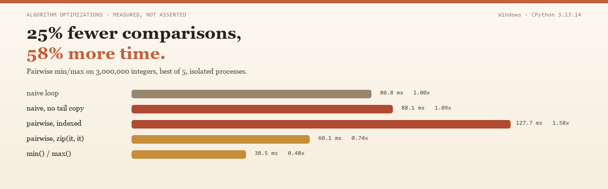

# algorithm-optimizations

**English** · [中文](README.zh-CN.md)



Four textbook optimizations. Measured, not asserted.

**Two of them do not survive contact with CPython** — and the two that fail are
the two that look most convincing on paper.

| # | The optimization | On paper | Measured here | Verdict |
|---|---|---|---|---|
| 1 | Pairwise min/max | `2(n-1)` → `3⌊n/2⌋` comparisons, −25% | **1.58× slower** than the naive loop | ✗ |
| 2 | Cache-blocked matmul | better locality, fewer cache misses | **1.01–1.25×**, sign not reproducible | ✗ |
| 3 | Bubble → cocktail shaker | fewer passes, early exit | **926×** on sorted, **0.97×** on reversed | ~ |
| 4 | Naive → DP → matrix power | `O(φⁿ)` → `O(n)` → `O(log n)` | 282 ms → 0.028 ms → 0.0066 ms | ✓ |

All numbers: CPython 3.13.14, Windows 11, Ryzen 7 H 255, best of N in isolated
processes (N = 5; N = 2 for the exponential Fibonacci case, which would otherwise
dominate the run). Full tables in [`benchmarks/RESULTS.md`](benchmarks/RESULTS.md),
raw data in [`benchmarks/results.json`](benchmarks/results.json). Each claim is
mapped to the command that produced it in [`docs/claims.md`](docs/claims.md).

## The interesting failure: pairwise min/max

Finding the minimum and maximum together costs `2(n-1)` comparisons. Compare
elements in pairs first — one comparison to order the pair, then one against the
running minimum and one against the running maximum — and you get `3⌊n/2⌋`,
about 25% fewer.

The comparison count is real. This repo counts it instead of trusting it
(`benchmarks/count_comparisons.py`, cell = measured / exact):

```
       n |            min_max_naive | min_max_pairwise_indexed |         min_max_pairwise
     100 |        198 / 198        ok |        148 / 148        ok |        148 / 148        ok
    1001 |      2,000 / 2,000      ok |      1,500 / 1,500      ok |      1,500 / 1,500      ok
  100000 |    199,998 / 199,998    ok |    149,998 / 149,998    ok |    149,998 / 149,998    ok
```

25% fewer comparisons, and **58% more wall-clock time** on 3M integers:

| Implementation | best ms | ratio | what it costs |
|---|---|---|---|
| `min_max_naive` | 80.82 | 1.00 | 2 comparisons per element, straight-line loop |
| `min_max_naive_nocopy` | 88.08 | 1.09 | same, without the tail copy — *control* |
| `min_max_pairwise_indexed` | 127.73 | **1.58** | pairs, `while` loop, `arr[i]` / `arr[i+1]` |
| `min_max_pairwise` | 60.10 | **0.74** | same algorithm, `zip(it, it)` |
| `min_max_builtin` | 38.54 | **0.48** | `min(arr), max(arr)` |

Why the second row loses: a comparison is one bytecode against integers that are
already in cache. `arr[i]` and `arr[i+1]` are two more bytecodes each, the pair
has to be packed and unpacked, and the `while` loop re-tests on every iteration.
Saving one comparison costs four bytecodes, and bytecodes are what CPython
actually spends time on.

Why the fourth row wins: the algorithm was never wrong, the transcription was.
Iterating with `zip(it, it)` keeps the pair loop in C and drops the indexing
entirely — same number of comparisons, about 2.1× faster than the indexed
version, and faster than the naive loop it was supposed to beat.

And the honest footnote: `min_max_naive_nocopy` is *slower* than the version with
the `arr[1:]` copy. Copying 24 MB of pointers is cheap; losing the fast list
iterator is not. Removing the copy does not rescue the baseline.

## The second failure: cache blocking in an interpreter

The inner loop of a matmul costs roughly 100 ns per step in CPython. An L2 cache
miss costs a few nanoseconds. Reordering the loops to improve locality cannot
pay for itself when the interpreter is 20× more expensive than the miss.

| Case | naive | blocked-8 | blocked-32 | blocked-64 | `zip` + `sum(map(mul))` |
|---|---|---|---|---|---|
| n = 128 | 69.49 ms | — | 81.83 ms (1.18×) | — | 51.79 ms (**0.75×**) |
| n = 160 | 149.27 ms | 187.21 ms (1.25×) | 153.45 ms (1.03×) | 150.47 ms (1.01×) | 99.00 ms (**0.66×**) |
| n = 192 | 242.46 ms | — | 271.12 ms (1.12×) | 252.81 ms (1.04×) | 159.75 ms (**0.66×**) |

The blocking effect does not track block size or matrix size, and it does not
even keep its sign: an interleaved run of the same `n = 160` case put
`blocked-64` at 0.91×, i.e. 9% *ahead*. An effect that flips between runs is an
effect smaller than the noise. The version that does win moves the inner product
into C: transpose `B` once, then
`sum(map(mul, row, col))` runs the whole row in C. Same `O(n³)` work, 1.3–1.5×
less time.

(It is also slightly *more* accurate on floats: since CPython 3.12 `sum()`
applies Neumaier compensation, so `matmul_zip` rounds differently from a plain
`+=` accumulator.)

## Where the wins are real

### Sorting: two changes, two different inputs

The obvious comparison — "bubble sort" versus "cocktail shaker with early exit"
— hides that two independent changes are being made. Split them:

| Input (n = 2000) | `bubble_sort` | `bubble_sort_early` | `cocktail_sort` |
|---|---|---|---|
| already sorted | 66.46 ms | 0.0716 ms — **929×** | 0.0718 ms — **926×** |
| 50 adjacent swaps | 66.00 ms | 0.1430 ms — **462×** | 0.1741 ms — **379×** |
| 50 far-apart swaps | 68.55 ms | 69.56 ms — 1.0× | 6.82 ms — **10.1×** |
| random | 111.87 ms | 114.52 ms — 1.0× | 102.40 ms — **1.09×** |
| reversed | 150.30 ms | 151.17 ms — 1.0× | 155.28 ms — **0.97×** |

`×` is how many times faster than `bubble_sort`; `1.0×` means no change, below 1
means slower.

- **Early exit alone** captures everything on genuinely near-sorted data: 929×
  on sorted input, and the bidirectional pass adds nothing on top of it.
- **Bidirectional alone** is what saves "few inversions, far apart" — 10.1× on
  the far-apart shape, where the early exit is worth exactly nothing (1.02×).
- **On reversed input** the cocktail version is 3% *slower*: every pass swaps
  every pair, and the second sweep is pure overhead.
- On random data the two are within ±10%, which is the machine's noise floor.

The shape labelled "nearly sorted" in most benchmarks is the third row — 50
swaps of arbitrary pairs, with displacements up to the full array. That is not
"nearly sorted" in the algorithmic sense, and it is why the same code can be
quoted as both a 10× win and a 900× win.

### Fibonacci: the complexity ladder is real, the wall clock is not linear

| n | `fib_naive` | n | `fib_dp` | `fib_matrix` |
|---|---|---|---|---|
| 25 | 9.64 ms | 100 | 0.0022 ms | 0.0026 ms |
| 28 | 38.34 ms | 1 000 | 0.0277 ms | 0.0066 ms |
| 30 | 107.46 ms | 10 000 | 0.9147 ms | 0.2271 ms |
| 32 | 282.35 ms | 100 000 | 63.42 ms | 7.96 ms |

The naive version multiplies by ~1.6 per increment of `n` (the golden ratio),
so n = 40 really is out of reach. The matrix version overtakes the DP somewhere
between n = 100 and n = 1000 — at 100 the DP is still 18% ahead, at 1000 the
matrix version is 4.2× ahead.

But read the growth, not just the exponents. Going from n = 1000 to n = 100 000
(100×) costs the DP **2290×** and the matrix version **1206×**. Both are far
superlinear: the loop counts improve, the numbers themselves get bigger, and
Python's big integers are not free. `O(log n)` multiplications of ever-larger
integers is not `O(log n)` time.

## Reproduce

```bash
git clone https://github.com/linluozi/algorithm-optimizations
cd algorithm-optimizations

python -m benchmarks.run_all --json benchmarks/results.json --markdown benchmarks/RESULTS.md
python -m benchmarks.run_all --mode interleaved   # ratio check, see below
python benchmarks/count_comparisons.py            # comparison counts, no timing
python -m unittest discover -s tests -t .         # 32 tests
```

`python -m benchmarks.run_all --quick` runs the same harness at small sizes in
about 5 seconds — that is what CI uses.

## Method, and why it is this fussy

- **One subprocess per (case, variant).** A variant that allocates 3M integers
  leaves a different heap behind; whatever runs next is measured on a dirtier
  machine. Here the effect is small; in a sibling repo an eager CSV reader that
  allocated 57 MB made the *next* algorithm look 2.4× slower than it was.
- **Best of N, not the mean.** Interference only ever makes a run slower, so the
  minimum is the least contaminated estimate. `median_ms` is reported for
  honesty; the claims use `best_ms`.
- **Fixed seeds.** Every input comes from `algopt/data.py`. The first version of
  this benchmark used bare `random.randint` and produced two different
  conclusions from the same command.
- **Interleaved mode for ratios.** Absolute times on this laptop drift by 40%
  between runs — the same naive loop measured 123 ms and 173 ms an hour apart.
  Per-round *ratios* survive that drift, because the drift hits every variant in
  the round equally. So: quote the isolated run, confirm with
  `--mode interleaved`.
- **Guards.** Before timing, every variant is checked on a tiny input, so a
  benchmark cannot silently measure a broken function.

Details in [`CONTRIBUTING.md`](CONTRIBUTING.md). If a proposed "simplification"
makes any of the above false, it is not one.

## Layout

```
algopt/
  sorting.py      bubble_sort, bubble_sort_early, cocktail_sort
  min_max.py      naive, naive_nocopy, pairwise_indexed (the trap), pairwise, builtin
  fibonacci.py    fib_naive, fib_dp, fib_matrix
  matmul.py       matmul_naive, matmul_blocked (negative result), matmul_zip
  data.py         seeded input generators
  bench.py        harness: isolated / interleaved, markdown + json output
benchmarks/
  run_all.py            python -m benchmarks.run_all
  count_comparisons.py  counts < and > instead of nanoseconds
  RESULTS.md            generated tables
tests/                  32 unittest tests
docs/claims.md          every README claim → the case that backs it
scripts/make_assets.py  regenerates assets/ from benchmarks/results.json
assets/                 banner + social preview, both drawn from the results
```

## What this is not

Not a benchmark of Python against C, and not an argument that these algorithms
are bad. They are correct, and on the hardware they were designed for — a machine
where a comparison and a cache miss are the expensive things — they are the right
answer. This repo is about the step where a paper result is transcribed into
Python and the cost model quietly changes underneath it.

## License

MIT. See [LICENSE](LICENSE).
